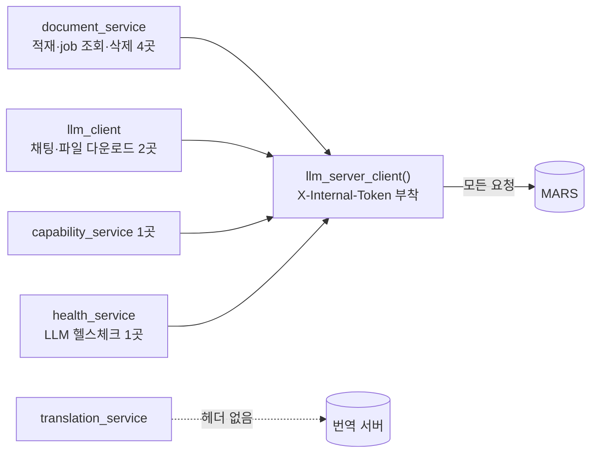

# MARS 요청에 `X-Internal-Token` 헤더 추가

> 백엔드 → MARS로 가는 **모든 요청**에 내부 인증 헤더를 싣는다. 번역 서버 요청에는 싣지 않는다.

## 변경 요약

| 파일 | 변경 |
|---|---|
| `app/core/config.py` | `llm_server_token` 추가 (**필수**, 기본값 없음) |
| `app/services/llm_client.py` | `llm_server_client(timeout)` 추가 — 헤더가 붙은 `httpx.AsyncClient` 반환 |
| `document_service` · `llm_client` · `capability_service` · `health_service` | MARS 호출 8곳의 `httpx.AsyncClient(...)` → `llm_server_client(...)` |

## 규칙

- MARS 호출은 반드시 `llm_server_client()`로 만든다 (호출부에서 헤더를 직접 붙이지 않음).
- 환경변수 `LLM_SERVER_TOKEN`이 없으면 **서버가 기동하지 않는다** (pydantic `Field required`).
  - 운영(GCP)은 시크릿으로 주입됨. **로컬 `.env`에는 직접 추가해야 한다.**

## 검증

- MARS 호출 지점 전수 확인: 남은 `httpx.AsyncClient`는 번역 서버(2곳)뿐
- 요청 헤더 확인: `X-Internal-Token` 부착 + 요청별 헤더(`Content-Type`)와 병합 OK
- 토큰 미설정 시 설정 로드 실패 확인
- 실제 MARS 연동 테스트는 하지 않음
